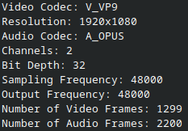
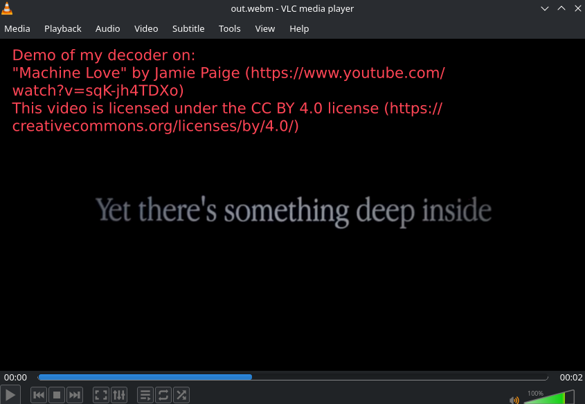

# webm-in-godot

> **NOTE:** This branch (`patches`) is for the **fixes** done on the original build of the project.\
> Currently, this includes fixes for the original **week 4** build of this project.

A program aiming to add additional webm video support to Godot to support more common video formats as Godot only currently supports the OGG Theora codec which some programs are unable to export to. 

**NOTE:** This project is currently a work-in-progress with only a **standalone VP9 decoder** for WEBM outside of Godot which is in the process of being ported to GDExtension.




## Running

Releases of the program can be found at https://fractured-sky.itch.io/webm-in-godot.

Currently, the standalone VP9 decoder must be ran from the **command line** and supports two input formats:

- An input WEBM file (`./out video.webm`)
- An input WEBM file and an output file for the first 64 raw decoded images (`./out video.webm output_images`)

After the decoder finishes parsing all of the frames, basic information about the video file is outputted to the console.

If an output file was specified, it can be converted back into a video using ffmpeg with the following command:

```sh
# RESOLUTION is the original video's resolution (such as 1920x1080)
# FRAMERATE is the original video's framerate (typically 30 or 60)
ffmpeg -f rawvideo -s RESOLUTION -pix_fmt yuv420p -framerate FRAMERATE -i output_images -c:v libvpx-vp9 -an out.webm
```

The output video `out.webm` can then be opened in a normal video player.

## External dependencies

This program uses the `godot-cpp` GDExtension bindings which are licensed under the MIT License. The license can be found under the `godot-cpp` submodule or on the [project's repository](https://github.com/godotengine/godot-cpp/tree/godot-4.2.2-stable).

This program depends on the `libwebm` and `libvpx` libraries which are licensed under the BSD-3-Clause License.

Licensing information for `libwebm` can be found on the [project's repository](https://github.com/webmproject/libwebm).

Licensing information for `libvpx` can be found on the [project's repository](https://github.com/webmproject/libvpx).

External libraries are not provided in this repository but should be installed on the system or placed under `thirdparty/include` (headers) and `thirdparty/lib` (shared libraries).

## Building

### Standalone Program

CMake is used to build a standalone decoder program.

Assuming that the needed libraries have already been installed on the system or are placed under `thirdparty`, the following commands can be ran to compile the program.

```sh
mkdir build
cmake -B build
cmake --build build
```

### GDExtension (Incomplete)

**NOTE:** The GDExtension portion of this project currently does not work. For now, these instructions are provided only for reference.

SCons is used to build the main GDExtension using godot-cpp.

First, make sure that the `godot-cpp` submodule has been initialized.

If it hasn't already been initialized, then run:

```sh
git submodule update --init
```

Then, run `scons` to compile the extension. Once compiling has finished, the extension should appear under the `project` folder.

Open the provided Godot project and verify that the GDExtension loads and functions properly before using it in other projects.
